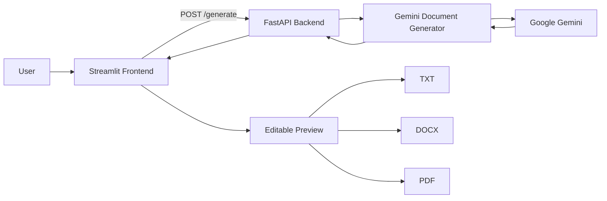

# Phase 3 — Project Design

## Architecture

## Components

### Frontend
Streamlit collects document type, parties, terms and date; displays the generated content; and provides editing/download controls.

### Backend
FastAPI exposes `/` and `POST /generate`, validates inputs with Pydantic and invokes the generator.

### AI Core
`ai_core/gemini_generator.py` creates the structured prompt and sends it to Gemini.

### Formatting Layer
`utils/document_formatter.py` creates TXT, DOCX and PDF outputs.

### Utility Layer
`utils/text_utils.py` sanitizes typographic punctuation and control characters.

## Data Flow
1. User submits form.
2. Streamlit sends JSON to FastAPI.
3. Pydantic validates the request.
4. Gemini generator builds the prompt.
5. Gemini returns draft text.
6. Backend sanitizes and returns the document.
7. Streamlit previews and lets the user edit it.
8. User downloads the selected format.

## UI Design
The supplied reference shows a centered LegalEase interface with a dark-themed preview and controls for generation, editing and downloading.
